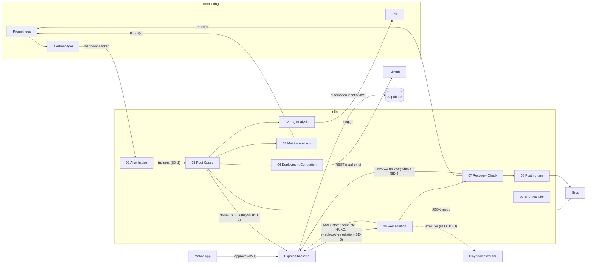
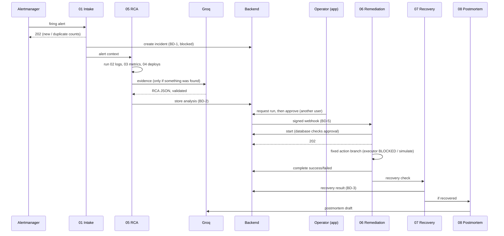

# Automation – Implementation Guide

How the n8n automation of the AI-Powered Mobile DevOps Command Center (Group 33) is built, how the workflows fit together, and how to change them.

## 1. Architecture



**Rules that hold everywhere:**
- n8n never talks to Supabase. It calls the backend's `/api/machine/*` routes with HMAC signatures, and the backend uses the automation identity (decisions A5 and D-001). There is no `service_role` key anywhere.
- The AI only recommends. Its answer is validated against a schema, stored as data and shown to a human. **No path leads from an AI answer to execution.** Workflow 06 starts only when the backend calls it after a human approval, and the database checks the approval again (`start_playbook_run`).
- The database writes the audit log. n8n writes no audit records.

## 2. Execution sequence



## 3. Ownership (Vishwa 40% / Tharindu 60%)

| Workflow | Owner | Share |
|---|---|---|
| 01 Alert Intake, 05 Root Cause, 06 Remediation, HMAC library, backend integration, end-to-end tests | **Vishwa** | ~40% |
| 00 Groq Test, 02 Logs, 03 Metrics, 04 Deployments, 07 Recovery, 08 Postmortem, prompts, workflow documentation | **Tharindu** | ~60% |
| 09 Error Handler, schemas, test data | shared | – |

The owner's GitHub account commits that workflow's files: `src/nodes/<workflow>/`, the generated `workflows/<workflow>.json` and the related tests. That way the contribution shows under the right person.

## 4. Repository layout

```text
automation/
  workflows/            generated n8n exports (import these)
  src/nodes/<wf>/       Code node scripts, one file per Code node
  src/lib/              shared helpers inlined into nodes (hmac.js, common.js, ai.js)
  prompts/              Groq system prompts (inlined at build time)
  schemas/              investigation-output, rca-output, postmortem-output, ai-output (original)
  test-data/            sample Alertmanager / Loki / Prometheus / GitHub payloads
  tests/                unit tests, HMAC interop test, n8n integration test + mocks
  scripts/build-workflows.mjs
  docker-compose.yml, .env.example, package.json
```

**Why the JSON is generated:** n8n Code nodes cannot import shared files. The build step copies `src/lib/*.js` and the prompts into each node, so the HMAC code exists once in the source and is tested once. It also produces valid connections and stable node ids.

## 5. Changing a workflow

1. Edit the node script in `automation/src/nodes/...`, or the workflow layout in `scripts/build-workflows.mjs`.
2. `cd automation && npm run build`. This regenerates `workflows/*.json`.
3. `npm test` (unit tests, including "the committed JSON is up to date").
4. Re-import the changed workflow into n8n (see the README).

You can also edit a workflow in the n8n editor and export it. If you do, copy the change back into `src/`, or the next build overwrites it.

## 6. Shared contracts

| Contract | File | Between |
|---|---|---|
| Investigation result | `schemas/investigation-output.schema.json` | 02/03/04 → 05 |
| RCA | `schemas/rca-output.schema.json` (extends `ai-output.schema.json`) | Groq → 05 → backend (BD-2) |
| Postmortem | `schemas/postmortem-output.schema.json` | Groq → 08 |
| Recovery result | `{ incident_id, playbook_run_id, status: recovered\|not_recovered\|unable_to_verify, db_status, checks_performed, evidence, ok, stored }` | 07 → 08 |
| Remediation webhook | `{ playbook_run_id, incident_id, action_type, request_payload }` + HMAC headers | backend → 06 (contract B.3) |
| Machine endpoints | `database/API_AND_INTEGRATION_CONTRACTS.md` B.3 | n8n → backend |

Status values separate four situations:
- **no evidence**: `no_evidence`;
- **source unavailable**: `unavailable`, `not_configured`;
- **invalid response**: `invalid_response`, `query_rejected`, `invalid_ai_response`;
- **workflow failure**: `workflow_failed`, plus the 09 error handler.

## 7. Reliability

| Concern | Implementation |
|---|---|
| Timeouts | Every HTTP node: Loki 15 s, Prometheus 10 s, GitHub 15 s, Groq 30 s, backend 15 s (configurable) |
| Retries | Connection errors: up to 2 retries, 2 s apart (Groq: 1). 4xx is never retried. Signed calls are not retried (nonce). |
| Rate limits | 429 → `rate_limited`, `retryable: true`, reported rather than hammered |
| Duplicate alerts | fingerprint + startsAt de-duplication; backend idempotency still needed (BD-1) |
| Partial evidence | 05 continues when 1–2 sources fail and marks `partial_evidence: true` |
| No evidence | 05 does not call the AI; the status says why |
| Invalid AI output | Schema validation; nothing invalid is stored |
| Recovery limits | `RECOVERY_MAX_CHECKS` (max 10), wait 5–3600 s |
| Failures | 09 sends a redacted summary; the full detail stays in the n8n execution log |

## 8. Known limitations

- The backend routes BD-1 to BD-5 are missing (see `automation-integration-requirements.md`), so incidents, analyses, recovery checks and postmortems are **not saved yet**.
- There is no playbook executor: remediation is refused (`disabled`) or simulated (`simulate`).
- De-duplication and nonce stores use workflow static data. n8n saves it only for production (active) executions, only per instance, and only **when an execution ends**. So two copies of the same request that arrive **while the first is still running** are both accepted by n8n. The integration test reproduced this. It is safe today because the real guarantees are in the backend and database:
  - a second `start` for the same run is refused (409, the run is no longer `approved`);
  - a reused n8n execution id is rejected (`23505`);
  - the backend checks nonces in the database (`consume_automation_nonce`).

  For alerts, BD-1 must be idempotent on the fingerprint for the same reason.
- Metric names, labels and the error-rate query must be agreed with the monitoring owner.
- `N8N_BLOCK_ENV_ACCESS_IN_NODE=false` is needed for the HMAC secret (decision D-N8N-1).
- Sub-workflow ids are fixed (`dc33wf..`). Importing through the CLI keeps them; importing through the editor UI may give new ids, so the Execute Workflow nodes must then be re-selected.
